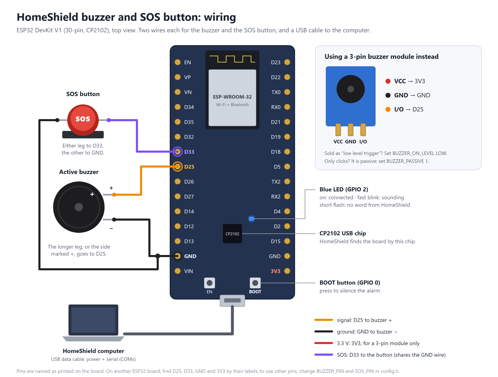

# 🛡️ HomeShield IoT

**HomeShield** is a centralized dashboard for **real-time CCTV monitoring** with three GPU-accelerated anomaly detectors running side-by-side on every camera feed. One unified pipeline draws bounding-box overlays on the live MJPEG stream, persists every alert to SQLite with an annotated snapshot, and pushes updates to the dashboard via Server-Sent Events.

**HomeShield IoT** adds an **alarm buzzer on an ESP32** (a DevKit with a CP2102 USB chip): when an incident starts, the buzzer in the house sounds a pattern for fire, a fall, an intruder or a danger zone until someone handles the incident or presses the button on the board. The same board has an **SOS button**: someone who needs help holds it, and HomeShield opens a critical incident, sends the WhatsApp alerts and sounds SOS on every buzzer. The board connects to the HomeShield computer with a USB cable, or over Wi-Fi.

It also turns ESP32 boards into **smart-home nodes**. Flash one sketch, set the board up from a phone, and map its pins from the dashboard: relays for lights, sockets, a fan, a door lock or a gas valve, a dimmer, a fan with speed control, and sensors for motion, flame, water, gas and temperature. Everyone can switch them and run **scenes** (e.g. Night: lamp 20 %, porch light on, door locked) from the **Devices** page. The boards talk to HomeShield over MQTT through its own Mosquitto broker.

Built as a Final-Year Project at the **International Islamic University Malaysia (IIUM), Kulliyyah of Information and Communication Technology**.

> One pipeline. Three detectors. Per-camera worker threads on one GPU, each with its own small pose model and sharing the fire and face models.

---

## ✨ Features

### Detection
- 🤸 **Fall detection** — any Ultralytics YOLO pose checkpoint (`yolov8`, `yolo11`, `yolo26`) feeds a research-tuned **7-state finite-state machine**: *Standing → Walking → Sitting → Fall_Detected → Lying_After_Fall → Lying_Motionless → Inactivity*. A two-stage decision (peak descent velocity **plus** sustained horizontal posture) rejects controlled sit-downs and false positives.
- 🔥 **Fire & smoke detection** — custom YOLO weights covering fire and smoke classes, with **per-class cooldown** to debounce repeated alerts.
- 👤 **Face / intruder detection** — InsightFace **ArcFace (buffalo_l)** generates 512-dimensional embeddings, cosine-matched against your registered Persons gallery. Unknown faces are auto-logged to the **Intruders** list with a snapshot.

### Identity & alerts
- **Registered persons** gallery — enrol family members from a still photo or a live capture.
- **Auto-intruder logging** — anyone not in the gallery is snapshot-logged with timestamp and camera.
- **Real-time alert stream** — Server-Sent Events push new events to the dashboard the instant they're published.
- **Incidents, not a wall of rows** — detections are grouped into incidents (one camera, one kind of trouble, no gap over 2 minutes), each with its peak confidence and best snapshot. Anyone signed in can **acknowledge** an incident or mark it a **false alarm**, with an optional note; the record keeps who did it, and a 7-day false-alarm count per detector and camera builds up on the Events page.
- **WhatsApp alerts (optional)** — one message through Twilio when an incident starts and one more if it escalates (e.g. a fall becomes "lying motionless"), never one per detection.
- **SOS button (ESP32, optional)** — a push button on the buzzer board for someone who needs help. A press opens a critical **SOS: help requested** incident named after the board, sends the WhatsApp alerts and sounds SOS in Morse code on every buzzer. The board sounds it at once, even with the computer off.
- **Alarm buzzer (ESP32, optional)** — sounds in the house when an incident starts, with its own pattern per kind (fire uses the three-beep rhythm of smoke alarms). It stops when the incident is acknowledged or marked a false alarm, when anyone presses **Silence buzzer** on the dashboard or the button on the board, or after a time limit. Connect it by USB (found automatically) or Wi-Fi.
- **Annotated snapshots** — every event is saved as a JPEG with the bounding box / pose skeleton / face label burned in.
- **Incident clips** — each incident also gets a short video, from 5 seconds before it began to 15 seconds after its last detection (both adjustable), with the detector overlays. Watch it in the incident window, on phones too, or download it. Clips are H.264 MP4 made with Windows' own encoder, about 1 MB each, and are deleted after 30 days (adjustable).

### Smart devices (ESP32 nodes)
- **Devices page** — every light, socket, fan, lock, valve, dimmer and sensor by room, with its live state, switches, dimmer sliders and fan speeds (Low, Medium, High). A dimmable light or speed fan has a switch too: off, then back on at its last level. Guests can switch them too; only admins add or change them.
- **Scenes** — set several devices at once with one tap (Night, Leaving home…).
- **Device activity** — who switched what and when, scenes, auto-lock, and boards going offline and coming back.
- **ESP32 nodes page (admins)** — the boards with their room, IP address, Wi-Fi signal, firmware and uptime; each board's **pin map** with a live value per pin and its MQTT topics; Blink LED (to find a board), Restart and **Update over Wi-Fi**.
- **ESP32 DevKit or ESP32-C3 SuperMini** — one firmware for both; each board says which it is, and the pin picker offers that board's own pins (with the ones to avoid listed and explained).
- **No-code setup** — a new board opens a setup hotspot for your Wi-Fi, then appears under **Found on your network**; adopt it and map its pins in a dialog that offers only the pins that suit each device.
- **Buzzers and SOS buttons on any node** — sound with the alarm and raise SOS incidents like the USB buzzer.

### Sensors (ESP32 nodes)
- **Sensors page** — the gas level in LPG ppm with its 1-hour, 24-hour or 7-day chart (hover or arrow keys for exact values, or a table), its warning and danger levels drawn on it, the last hour's min/avg/max, and the fan and valve in the same room. Flame, water-leak and motion sensors show their state and how often they fired.
- **Levels with a hold time** — a sensor must stay above a level for a few seconds (10 s for gas) before it counts, and drop clearly below it to clear, so one odd reading doesn't raise an alarm. A cold MQ-2 is ignored for the first 90 s after power-up.
- **Automatic responses** — a checklist per level: switch on the exhaust fan, close the gas valve, switch off sockets, notify on the dashboard and by WhatsApp, sound the buzzer, open an incident. Defaults: gas warning → fan on + notify; gas danger → buzzer + close valve + incident; flame → buzzer + close valve + incident; water leak → notify.
- **An alert on every page** — a banner on every open dashboard until someone acknowledges it, with **Close gas valve** and **Sound alarm** at hand. Acknowledging stops the buzzer and closes the incident.
- **Home / Away** — a switch in the top bar. While Away, a PIR seeing motion opens an intruder incident and sounds the buzzer; at Home motion is only counted.
- **Calibration** — press Calibrate once with the MQ-2 in clean air; until then the cleanest air seen so far is the baseline.
- **Sensor incidents** — in the Incidents list with the camera ones, showing the sensor and its reading (e.g. *Gas level high · node-kitchen · MQ-2 · 1,924 ppm*), sent over WhatsApp the same way.

### Automations (admins)
- **When → And only if → Then** — each automation has triggers (any one starts it), conditions (all must hold) and steps run in order. They run on the HomeShield server, so they work with every dashboard closed.
- **Triggers** — a sensor reaching a level; a camera detection (fall, fire or smoke, unknown face, child in a danger zone, SOS); a person seen on a camera; a time of day on chosen days, including sunrise or sunset with an offset (worked out daily for a Malaysian city); HomeShield events (monitoring started or stopped, switched to Home or Away); a relay or dimmer switched (e.g. the door unlocked).
- **Conditions** — time of day (it may pass midnight, or run from sunset to sunrise), days of the week, Home or Away, a device on or off, a sensor's level, monitoring on or off.
- **Steps** — switch a device; switch a group (*every light*, *every lock*, *everything in the Living room*, or *where it happened*: the camera's or sensor's room); run a scene; notify (every open dashboard plus WhatsApp); sound the buzzer; open an incident (sensor triggers); wait (e.g. porch light on, wait 5 min, off); switch Home/Away; start or stop monitoring.
- **Options** — wait before running again; run even when monitoring is stopped; retry once if an ESP32 node doesn't confirm a switch.
- **Recent runs** — what triggered it and what each step did, including a node that didn't reply. **Test run** does the steps now (devices really switch; no incident is opened).
- **Starters** — Fall → lights on, Fire detected, Night visitor, Unknown face while away, Arm & leave and Evening lights are added switched off, using your devices.
- **One set of rules** — the Sensors page's checklists are automations too; **Edit rule →** opens them here, and once you add conditions or other steps they are edited here only.

### Zones
- **Polygon zones per camera** drawn directly on the live preview.
- **Safe zones** suppress lying / inactivity alerts (e.g. on a bed or sofa). A fall or lying there is still drawn on the video, in grey and marked *ignored*.
- **Danger zones** trigger a child-entry alert when a person crosses into them (kitchen, balcony, pool, etc.).
- **Fireplace zones** ignore fire and smoke that stays inside them (a fireplace, a gas stove, candles). A flame counts as inside when at least 60% of its box is; a fire spreading out of the zone still alerts. Ignored flames stay on the video in grey, labelled *ignored*.

### Platform
- **Who's online (admins)** — the sidebar shows which accounts are using the dashboard right now, on which devices (phone or computer), whether the tab is in front, whether they came in over the internet, and when every other account was last seen. **Settings → Users** shows the same in its **Last seen** column. Guests see the monitoring state there instead.
- **Multi-camera** — webcams, IP cameras (RTSP), DroidCam, IP Webcam, or a video file for testing.
- **Live MJPEG streams** with detector overlays.
- **SQLite event log** in WAL mode + filesystem snapshots.
- **Hot-reloadable settings** — toggle detectors, swap pose models, change FPS / imgsz / thresholds without restarting cameras.
- **Mobile-friendly UI** — responsive Flask dashboard you can hit from your phone on the same network.

---

## 📋 Requirements

### Recommended setup (what this is tuned for)
- **OS:** Windows 11
- **Python:** 3.11 (Anaconda virtual environment)
- **GPU:** NVIDIA GPU with **CUDA 12.x** drivers (tested on RTX-class hardware)
- **PyTorch:** 2.x with CUDA build
- **RAM:** 16 GB+
- **Disk:** ~5 GB for weights, snapshots, and the SQLite database

### Minimum (CPU-only, no intruder detection)
You can run HomeShield on a machine without a GPU, but with caveats:
- **CPU-only** PyTorch and ONNX Runtime work for **Fall** and **Fire** detection — expect 5–15 FPS on a modern laptop CPU at small image sizes.
- **Face / intruder detection should be disabled** — InsightFace inference on CPU is too slow to keep up with a live feed and will tank the pose framerate.
- 8 GB RAM minimum.
- Lower the **imgsz** and **target FPS** in *Settings → Performance* aggressively (e.g. imgsz 416, FPS cap 10).

### Python version note
**Python 3.11 is required.** The bundled InsightFace wheel (`insightface-0.7.3-cp311-cp311-win_amd64.whl`) is compiled specifically for **CPython 3.11 on Windows x64**. Other Python versions will fail to install it from source unless you have MSVC build tools configured. If you must use a different Python version, you'll need to compile InsightFace yourself or find a matching pre-built wheel.

---

## ⚡ Installation

### 1. Get Python 3.11
Install Python 3.11 via Anaconda (recommended) or the official installer:

```bash
# With Anaconda
conda create -n homeshield python=3.11
conda activate homeshield
```

Verify:

```bash
python --version
# Python 3.11.x
```

### 2. Open the project folder and create a venv

Copy the `HomeshieldIOT` folder to the computer, then open a terminal in it:

```bash
cd HomeshieldIOT

# If you skipped the conda step above, create a plain venv:
python -m venv venv
# Windows:
venv\Scripts\activate
# macOS / Linux:
source venv/bin/activate
```

### 3. Install PyTorch (do this BEFORE requirements.txt)
**This step is critical.** If you let pip resolve PyTorch from `requirements.txt`, it will pull the **CPU-only** build. Install PyTorch from a CUDA index **first**, and note which CUDA version you picked; step 5 has to match it:

```bash
# CUDA 12 (recommended; NVIDIA driver 525 or newer)
pip install torch torchvision --index-url https://download.pytorch.org/whl/cu121

# CUDA 13 (NVIDIA driver 580 or newer)
pip install torch torchvision --index-url https://download.pytorch.org/whl/cu130

# CPU-only fallback (no NVIDIA GPU)
pip install torch torchvision --index-url https://download.pytorch.org/whl/cpu
```

Run `nvidia-smi` to see your driver version. Verify CUDA is detected:

```bash
python -c "import torch; print('cuda', torch.cuda.is_available(), torch.version.cuda)"
```

### 4. Install InsightFace (Windows-specific)
On Windows without MSVC build tools, pip cannot compile InsightFace from source. Use the **bundled pre-built wheel** instead:

```bash
pip install Face_Detection/insightface-0.7.3-cp311-cp311-win_amd64.whl
```

(Use the `cp310` wheel on Python 3.10.) On macOS / Linux, or Windows with MSVC installed, `pip install insightface==0.7.3` works directly and step 5 handles it.

### 5. Install the rest

`requirements.txt` installs HomeShield in editable mode with the **CUDA 12** build of ONNX Runtime (which runs the face models):

```bash
pip install -r requirements.txt
```

If you installed the CUDA 13 or CPU build of PyTorch in step 3, install the matching extra instead:

```bash
pip install -e .[plot,cuda13]
```

```bash
pip install -e .[plot,cpu]
```

ONNX Runtime's CUDA version must match PyTorch's (`onnxruntime-gpu` 1.27+ needs CUDA 13, 1.26 and older need CUDA 12). With a mismatch, face recognition silently falls back to the CPU; HomeShield logs a warning naming the fix, and `/healthz` reports `face_device`.

The other pins avoid real breakages:
- `numpy<2.0`: InsightFace wheels are compiled against NumPy 1.x.
- `opencv-python` and `opencv-python-headless` are both kept on 4.10.x. Ultralytics needs the first and InsightFace's `albumentations` the second, and both install into the same `cv2` folder.
- `lap` is required by the person tracker (Ultralytics 8.3 and 8.4 both import it). HomeShield also turns off Ultralytics' auto-installer, which otherwise runs whatever `pip` is on your PATH and can install into a different Python.

Whichever OpenCV package was written last provides `cv2`. The dashboard works with either. Only the standalone fall runner's `--show` window needs the GUI build; if it reports that the window is unavailable, restore it with:

```bash
pip install --force-reinstall --no-deps "opencv-python~=4.10.0"
```

Verify the full stack loads cleanly:

```bash
python -c "import torch, cv2, ultralytics, insightface, onnxruntime, lap; print('torch', torch.__version__, 'cuda', torch.cuda.is_available()); print('cv2', cv2.__version__); print('onnxruntime', onnxruntime.__version__, onnxruntime.get_available_providers())"
```

Optionally run the tests (no GPU or weights needed):

```bash
pip install pytest
```

```bash
python -m pytest
```

### 6. Configure
- Drop YOLO **pose weights** (`*-pose.pt`) into `Fall_Detection/weights/`. The dashboard's **Settings → Fall detection** dropdown auto-populates from whatever's in that folder.
- Make sure **Fire_Detection/best.pt** exists (the custom fire/smoke weights).
- The first time you run the app, it creates `homeshield.db`, `snapshots/`, `person_photos/`, and `intruder_photos/` automatically.
- *(Optional)* WhatsApp alerts: in **Settings → Notifications → Twilio account**, paste your **Account SID**, **Auth token** and **WhatsApp sender** number from the Twilio Console, add the phone numbers under **WhatsApp alerts**, save, and use **Send test message**. The auth token is write-only: it is stored in `homeshield.db` and never shown again (**Remove saved token** deletes it). The **WhatsApp sender** is Twilio's WhatsApp number (on a trial, the one shown on the Console's **Try out WhatsApp** page), not your own phone. Each receiving phone must be a verified tester and first send the join code from that page (e.g. `join twilio-trial`) to the sender number. Without these values, WhatsApp stays off and nothing leaves the machine.

  **Twilio trial accounts only send Twilio's own message templates** (free text fails with "ContentSid Required"). Copy the template's `contentSid` (starts with `HX`) from the code sample on the Try out WhatsApp page into **Message template**. Trial templates have fixed wording, so the message tells you to check HomeShield rather than what happened. After upgrading Twilio you can get your own template approved, e.g. *"HomeShield: {{1}} on {{2}} at {{3}} (confidence {{4}})"*, and tick **My template has {{1}} to {{4}}** so alerts fill in what, where, when and how sure. Leave Message template empty to send HomeShield's own text (works on upgraded accounts within WhatsApp's 24-hour reply window).

  You can also keep the details in a private `.env` file next to `run_homeshield.py` (values saved in Settings take priority):
  ```
  TWILIO_ACCOUNT_SID=ACxxxxxxxxxxxxxxxxxxxxxxxxxxxxxxxx
  TWILIO_AUTH_TOKEN=your_auth_token
  TWILIO_WHATSAPP_FROM=+14155238886
  ```

### 7. Run

```bash
python run_homeshield.py
```

Then open the dashboard at **http://localhost:5000/**.

Common flags:

```bash
# Custom port and DB
python run_homeshield.py --port 8080 --db custom.db

# Bind only to localhost (default 0.0.0.0 lets phones on the LAN reach it)
python run_homeshield.py --host 127.0.0.1

# Don't auto-start cameras on boot (useful for debugging)
python run_homeshield.py --no-autostart

# Also open remote access through a Cloudflare Tunnel (see step 8)
python run_homeshield.py --tunnel

# MQTT broker for ESP32 nodes on another port, or not at all (see step 10)
python run_homeshield.py --mqtt-port 1885
python run_homeshield.py --no-mqtt
```

### 8. Remote access (optional, Cloudflare Tunnel)

HomeShield can make itself reachable from anywhere through a [Cloudflare Tunnel](https://developers.cloudflare.com/cloudflare-one/networks/connectors/cloudflare-tunnel/). `cloudflared` opens an outbound connection to Cloudflare, so no port on your router is opened, and Cloudflare provides HTTPS.

1. Install `cloudflared` once:
   ```bash
   winget install --id Cloudflare.cloudflared
   ```
2. Change the default admin password. The tunnel refuses to open while `admin` / `admin` still works.
3. Start HomeShield with `--tunnel`:
   ```bash
   python run_homeshield.py --tunnel
   ```
   The console prints an address like `https://<random-words>.trycloudflare.com`. Admins also see it in **Settings → About**.

This is a **Quick Tunnel**: free and needs no Cloudflare account, but the address changes every time HomeShield starts, there is no uptime guarantee, and it does not carry Server-Sent Events. Over a Quick Tunnel the dashboard therefore checks for new incidents every 4 seconds instead of instantly.

For a **permanent address** on your own domain, use a named tunnel. You need a free Cloudflare account and a domain whose DNS is on Cloudflare.

1. *Networking → Tunnels → Create a tunnel*, give it a name (e.g. `homeshield`), choose Windows, and copy the long token from the install command it shows (the part starting with `eyJ`). You don't need to run that command: HomeShield starts the tunnel itself.
2. Recommended before publishing: *Zero Trust → Access controls → Applications → Create new application → Self-hosted and private*, add the same hostname, and allow only your family's email addresses with One-time PIN. Visitors then confirm a code sent to their email before they even see the HomeShield sign-in page.
3. Open the tunnel, go to *Routes → Add route → Published application*, and set **Subdomain** `homeshield`, **Domain** your domain, **Service URL** `http://localhost:5000`.
4. Put the token and the address in `.env` next to `run_homeshield.py` (keep it secret):
   ```
   CLOUDFLARE_TUNNEL_TOKEN=eyJ...
   HOMESHIELD_PUBLIC_URL=https://homeshield.example.com
   ```
5. Start HomeShield as usual; the tunnel opens with it:
   ```bash
   python run_homeshield.py
   ```

(`--tunnel-token` and `--public-url` do the same from the command line.) Named tunnels keep instant (SSE) alerts. If the token ever leaks, refresh it in the tunnel's settings and update `.env`.

What changes while remote access is on:

- Visitors arrive over HTTPS, and their session cookie is marked `Secure`. Sign-in lockout counts each visitor's real address (passed on by Cloudflare), so one person's typos can't lock everyone else out.
- From the internet, the sign-in page shows only that HomeShield is online: not whether cameras are being watched, and never the first-run password hint.
- Cloudflare terminates HTTPS at its edge, so video you watch remotely passes through Cloudflare's network. Detection and storage still happen only on your computer, and nothing is relayed unless someone signs in and opens a stream. For extra protection on a named tunnel, add a Cloudflare Access policy (for example an email one-time PIN) in front of the hostname.
- `cloudflared` runs as part of HomeShield and stops with it, even when HomeShield is closed from Task Manager.
- To allow only this computer plus the tunnel (no other LAN devices), add `--host 127.0.0.1`.
- The alarm buzzer's own endpoints don't exist through the tunnel: a board has to be on your home network.

### 9. Alarm buzzer (optional, ESP32)

You need an ESP32 DevKit (the common ESP-WROOM-32 board with a CP2102 USB chip), a buzzer and a USB **data** cable. **[firmware/README.md](firmware/README.md)** has the wiring, how to upload the sketch with the Arduino IDE, and the optional Wi-Fi setup. In short:




1. Wire the buzzer to **GPIO 25** and **GND** (a buzzer module also takes **3V3**), and the SOS push button between **GPIO 33** and **GND**.
2. Upload `firmware/HomeShieldBuzzer` to the ESP32 from the Arduino IDE (board **ESP32 Dev Module**). Close the Serial Monitor afterwards: only one program can use the port.
3. Plug the ESP32 into the HomeShield computer and start HomeShield. It finds the board by its CP2102 chip and a handshake; **Settings → Alarm buzzer** then says it is connected over USB.
4. In **Settings → Alarm buzzer**, press **Test buzzer** (three beeps), and choose which incidents sound it and when it stops on its own.

For a buzzer away from the computer, fill in `WIFI_SSID`, `WIFI_PASSWORD`, `SERVER_URL` and `DEVICE_KEY` in `firmware/HomeShieldBuzzer/config.h` and upload again. `SERVER_URL` is `http://` + the address shown on the ESP32 nodes page + `:5000`; `DEVICE_KEY` is the key shown there (**Add an ESP32 node**, Show or Copy). The board can use USB and Wi-Fi at the same time.

### 10. ESP32 nodes and smart devices (optional)

For lights, locks and sensors around the house, each ESP32 runs the **HomeShield node** sketch and talks to HomeShield over MQTT. **[firmware/HomeShieldNode/README.md](firmware/HomeShieldNode/README.md)** has the details. In short:

1. Install Mosquitto once on the HomeShield computer:
   ```bash
   winget install EclipseFoundation.Mosquitto
   pip install "paho-mqtt>=2,<3"
   ```
   HomeShield starts its own broker on port **1884** (your own Mosquitto service on 1883, if any, is left alone). When Windows Firewall asks about **mosquitto.exe**, allow it on private networks.
2. Upload `firmware/HomeShieldNode` to the board from the Arduino IDE (needs the WiFiManager, PubSubClient, ArduinoJson and DHT sensor libraries).
3. Join the board's **HomeShield-Setup-…** hotspot from a phone and enter your Wi-Fi and the HomeShield computer's address and device key: both are on the ESP32 nodes page under **Add an ESP32 node**, with Copy buttons (the key stays hidden until you press Show).
4. Open **ESP32 nodes**, press **Adopt** on the board under *Found on your network*, then **+ Map another pin** for each relay or sensor. The devices appear on the **Devices** page.

To try it without hardware, `python tools/sim_node.py --key <device key> --boards 3` runs pretend boards.

---

## 📸 Camera setup

HomeShield accepts any source OpenCV's `VideoCapture` understands — webcams, RTSP / HTTP streams, and video files. Add cameras from **Live feeds → Add camera** in the dashboard.

### Built-in webcam
Use the integer device index. `0` is your default webcam:

```
Source: 0
```

If you have multiple webcams, try `1`, `2`, etc.

### IP cameras over RTSP (Tapo, VIGI, Hikvision, Dahua, …)
HomeShield works with any IP camera that exposes an **RTSP** stream. The general form is:

```
Source: rtsp://<user>:<password>@<camera-ip>:<port>/<stream-path>
```

Most consumer cameras use port `554`. Many manufacturers offer a high-quality main stream and a lower-bitrate sub-stream — **the sub-stream is strongly recommended for 24/7 monitoring** because it stays well within the GPU / CPU budget when you're running multiple cameras side-by-side. Below are the URL patterns for the brands HomeShield has been validated against.

#### TP-Link Tapo (C100, C200, C210, C220, C310, C320WS, etc.)
1. Open the **Tapo app → your camera → Camera Settings → Advanced Settings → Camera Account**.
2. Toggle **Camera Account** on and set a username + password (this is the RTSP credential, separate from your Tapo login).
3. Use the URL:

```
Source: rtsp://<user>:<password>@<camera-ip>:554/stream1   # high quality (2K / 1080p)
Source: rtsp://<user>:<password>@<camera-ip>:554/stream2   # lower quality, lower bandwidth
```

#### TP-Link VIGI (C300, C400, C540, NVR channels)
1. In the **VIGI Security Manager** (or web UI) → **Settings → Network → Advanced → RTSP** — make sure RTSP is enabled and note the port (default `554`).
2. Create an ONVIF / RTSP account under **Settings → System → User Management**.
3. URL pattern:

```
Source: rtsp://<user>:<password>@<camera-ip>:554/stream1   # main stream
Source: rtsp://<user>:<password>@<camera-ip>:554/stream2   # sub stream
```

For VIGI NVR channels, append the channel number, e.g. `…/stream1?channel=2`.

#### Hikvision (DS-2CD…, Ezviz under the hood)
1. Web UI → **Configuration → Network → Advanced Settings → Integration Protocol** — enable **ONVIF** and create an ONVIF user, or use the admin account.
2. Web UI → **Configuration → System → Security → Authentication** — set **RTSP Authentication** to `digest/basic`.
3. URL pattern:

```
Source: rtsp://<user>:<password>@<camera-ip>:554/Streaming/Channels/101   # main stream, ch 1
Source: rtsp://<user>:<password>@<camera-ip>:554/Streaming/Channels/102   # sub stream, ch 1
```

For multi-channel NVRs, the channel encoding is `<channel><stream>` — e.g. `201` = channel 2 main, `202` = channel 2 sub.

#### Dahua (IPC-HDW…, Lorex, Amcrest rebrands)
1. Web UI → **Setup → Network → Connection → RTSP** — confirm port (default `554`).
2. Create or reuse an admin / operator account under **Setup → System → Account**.
3. URL pattern:

```
Source: rtsp://<user>:<password>@<camera-ip>:554/cam/realmonitor?channel=1&subtype=0   # main stream
Source: rtsp://<user>:<password>@<camera-ip>:554/cam/realmonitor?channel=1&subtype=1   # sub stream
```

`subtype=0` is the main stream, `subtype=1` is the sub stream. Change `channel=` for NVR channels.

#### Generic ONVIF / other brands
If your camera isn't listed above, check the manufacturer's docs for "RTSP URL" or "ONVIF stream URI". Tools like **ONVIF Device Manager** or **VLC → Media → Open Network Stream** can probe a camera and reveal its working RTSP path. Once you have the URL, paste it into HomeShield's **Live feeds → Add camera → Source** field exactly as-is.

> 💡 **TCP vs UDP:** if the stream connects but stutters or freezes, OpenCV may be defaulting to UDP transport on a lossy network. You can force TCP by exporting `OPENCV_FFMPEG_CAPTURE_OPTIONS=rtsp_transport;tcp` before launching HomeShield.

### Android phone as camera (DroidCam, IP Webcam)
Both apps expose a phone's camera as a network stream:

- **DroidCam** (Wi-Fi mode):
  ```
  Source: http://<phone-ip>:4747/video
  ```
- **IP Webcam**:
  ```
  Source: http://<phone-ip>:8080/video
  ```

Make sure both devices are on the same Wi-Fi network and the phone screen stays on.

### Video file for testing
Drop in any local video file to dry-run the detectors without a live camera:

```
Source: C:/path/to/sample_fall.mp4
Source: ./test_videos/kitchen_fire.mp4
```

The pipeline loops the file and plays it in real time, like a camera: when the GPU can't analyse every frame (or *Frames analysed per second* caps it), the frames whose time has passed are skipped instead of the video slowing down. Each analysed frame keeps the video's own timestamp, so fall speeds and timings match what a live camera would produce.

---

## 🎯 Using the system

### Register your family members
1. Make sure face recognition is on (**Settings → Face recognition**); registering needs it.
2. Go to **People → Register a person**, enter the person's name and press their category (**Elderly**, **Adult** or **Child**).
3. Under **Take the face from**, either:
   - press a camera, ask them to look straight at it, and press **Capture from camera** once the preview says **FACE OK**; or
   - press **Photo file** and choose a clear photo of their face from this computer (or drop the photo on the preview), then press **Register from photo** once it says **FACE OK**. In a group photo the largest face is used. The page sends a copy at most 1600 px wide; JPG and PNG work; iPhone HEIC photos may not open in the browser.
4. Repeat for every household member.

Each person gets a card with their photo (head and shoulders), name and category; the picture's background is gold for Elderly, blue for Adult and green for Child. The card also says when a camera last recognised them and which one, for example **Seen 5 min ago at Living room** (a green dot means the last 10 minutes), or **Not seen yet**. The time is saved at most once a minute per person, so it survives a restart. To remove someone, press the bin on their photo. People registered before this version keep their older, tighter face photo until you register them again.

> ⚠️ **Important:** Register everyone soon after turning face recognition on. Until then, household members show up under **People → Intruders seen**; you can register them straight from there.

### Set up zones
1. Open **Zones**, pick a camera from the list.
2. Click on the live preview to lay polygon vertices, then close the polygon.
3. Tag the zone:
   - **Safe zone** → suppresses lying / inactivity alerts inside it (use this for beds, sofas, recliners).
   - **Danger zone** → triggers a child-entry alert when anyone enters (kitchen, balcony, pool, stairs).
   - **Fireplace zone** → fire and smoke that stays inside it are ignored (fireplace, stove, candles); a fire spreading beyond it still alerts.
4. Save. Zones apply live, no restart needed.

### Watch the live feed
**Live feeds** is the main dashboard:
- A one-line verdict at the top says **All clear**, or names the most urgent open incident and where it is, such as **Gas level high · Kitchen**, with when it started and how many more are open below it, and a **What to do** button that opens it (it says **Not monitoring** when the system is stopped, rather than claiming all is well).
- Each camera shows the annotated MJPEG stream with bounding boxes, pose skeletons, and face labels overlaid.
- The incident board lists open incidents first, then the ones recently handled, and updates in real time via Server-Sent Events.

### Handle incidents
Click (or tap) an incident to open it: a video of the incident (or, while it is still being recorded, the most confident snapshot), how long it lasted, how many detections it grouped, and a timeline of the first, peak, escalating and last detections. **Download clip** saves the video, e.g. to send it to a relative.
- **View live** jumps to that camera.
- **Acknowledge** — you've seen it and dealt with it. **False alarm** — the detector was wrong. Either can carry a short note, and either can be changed later. While an incident is still happening, Acknowledge is no longer the main button: once it's acknowledged, more of the same won't alert again unless it gets worse.
- An open incident with nothing new for 12 hours moves under **Still open from earlier**. Old ones alone no longer keep the house amber: the verdict reads calm on Live (**No new incidents**, or the monitoring state) and notes how many are still open. **Acknowledge all** on that divider closes them in one go, with **Undo** for two minutes.
- When nothing at all happened in the last 7 days, **Incidents** says so in one line instead of showing a row of zeros.
- If a closed incident gets worse (a fall turns into "lying motionless"), it reopens marked **Escalated**.
- **Incidents** shows every incident with status, type and camera filters, the 7-day false-alarm counts, and a **Detection log** view of the individual detections. **Clear history** (admins only) deletes incidents, their clips and the log.

### Sensors, levels and Away

Open **Sensors**. The big chart shows the selected sensor; click another sensor's card below to show it instead.

- **Thresholds** (admins): the warning and danger levels, how often the board reads it, and how long it must stay above a level. For the MQ-2 also how its output is wired (see [firmware/HomeShieldNode/README.md](firmware/HomeShieldNode/README.md#wiring-the-sensors)) and **Calibrate**.
- **Automatic response** (admins): tick what happens at each level. The devices offered are the ones in the sensor's room. Each tick saves at once and the message names it ("Turned off: “Close Gas valve” (danger level)."); turning a step off offers **Undo**.
- When a sensor reaches a level, every dashboard shows a banner. **Acknowledge** it once someone is dealing with it: the buzzer stops and its incident is closed with your name. The banner comes back if it gets worse.
- Switch the top bar's **Home** to **Away** when everyone leaves; motion sensors then raise the alarm. Anyone signed in can switch it.
- Readings are kept per minute for 30 days.

### Automations

Open **Automations** (admins). Pick a rule in the **Rules** list on the right or press **+ New automation**.

1. Under **When**, add one or more triggers; any of them starts it.
2. Under **And only if**, add conditions that must all hold (e.g. *Between 22:00 and 06:00*, *HomeShield is Away*).
3. Under **Then**, add the steps; ↑ ↓ change their order, a **Wait** step pauses before the next.
4. **Save**, then **Test run** to try the steps now. Its switch in the list pauses or resumes it, and who paused it is shown.

The starters arrive switched off: open one, check its steps fit your home, and switch it on. Sunrise and sunset follow the city chosen below the rule list (Kuala Lumpur at first).

A rule that runs ten times within a minute is held back (two rules switching each other back and forth), and the activity log says so.

### Silence the buzzer
While the ESP32 buzzer sounds, the verdict at the top of **Live feeds** shows **Silence buzzer**, for guests too. Silencing stops the noise but leaves the incident open, so it still needs **Acknowledge** or **False alarm**. The **BOOT** button on the board does the same. A repeat detection inside a silenced incident stays quiet; the buzzer sounds again only for a new incident, or if this one gets worse. The exception is the SOS button: every press is a person asking again, so it sounds again even after someone silenced it.

| Sound | Incident |
|---|---|
| Three beeps, pause (smoke-alarm rhythm) | Fire or smoke |
| ··· ––– ··· (SOS in Morse code), pause | Someone pressed an SOS button |
| Two long beeps, pause | Fall |
| Fast beeping without a pause | Intruder |
| Three quick chirps, pause | A child in a danger zone |
| Three low beeps, once | The board lost contact with HomeShield for 15 s |

### Handle intruders
When an unknown face appears, a card pops into **People → Intruders seen** with a snapshot on rose, and where and when it was seen (**Seen 3 min ago at Front door**). From there you can:
- **Register** them (name and category) if it's someone you know. They keep the snapshot as their photo, and the sighting as their last seen.
- **Dismiss** the entry if it was a false positive (poor lighting, motion blur, partial face). A dismissed card turns slate.
- **Delete** a dismissed entry and its photo for good with the bin on its photo (tick **Show dismissed** to see them).

---

## ⚙️ Tuning for your hardware

All knobs live in **Settings** and apply live without restarting cameras. Changing the pose / fire model file or the FP16 switch reloads that model automatically.

| Setting | Effect | When to adjust |
|---|---|---|
| **Pose model** | Smaller (`yolo11n-pose`) = faster, less accurate. `yolo26x-pose` = slowest, best accuracy. | Drop to `n` on CPU or low-end GPU. |
| **imgsz** | Inference resolution (320 / 416 / 640). | Lower for more FPS, higher for far-away subjects. |
| **Frames analysed per second** | Frames per second each camera's detectors analyse; 0 = every frame the camera sends. Default 10. | 10 is plenty for falls; 0 costs about 3× the CPU on a 30 FPS camera. |
| **Live view: frames per second / picture size** (*Settings → Cameras*) | What each viewer is sent: default 10 FPS at 960 px wide. Detection is unaffected. | Lower for phones or slow Wi-Fi; raise for a smoother picture. |
| **Decode video on the graphics card** (*Settings → Cameras*) | Network streams and video files are decoded by the GPU (D3D11 on Windows), about half the CPU per frame; a camera that can't use it falls back to the CPU by itself. Webcams always use the CPU. | Leave **on**; applies when a camera reconnects. |
| **FP16 (half-precision)** | Halves model memory on NVIDIA GPUs. At one frame per call the speed gain is small (~3% for `yolo11x-pose` on an RTX 4070); detections are unchanged (keypoints within 0.1 px of FP32). | Leave **on**; it is ignored on CPU. |
| **Frame skipping** | Pose runs every frame; fire every 2nd; face every 5th. | Bump face skip if face inference is the bottleneck. |
| **Fire / Face enabled** | Toggle the heavier detectors. | Disable face on CPU-only setups. |
| **Sensitivity (fall)** | Adjusts the FSM thresholds for descent velocity and lying duration. | Raise if false-falls are common; lower if real falls are missed. |
| **Cooldowns** | Min seconds between repeat alerts of the same class. | Raise for noisy environments. |

Advanced settings (not in the UI yet; set them with `POST /api/settings`):

| Key | Default | Effect |
|---|---|---|
| `fire_confirm_frames` / `fire_confirm_window` | 3 / 5 | Fire or smoke must be detected in 3 of the last 5 fire checks before alerting. Rejects one-frame false positives (lamps, sunsets, orange clothing). |
| `face_min_size` / `face_min_det_score` | 40 px / 0.6 | Faces smaller or less certain than this are shown as `?` and never matched, so they cannot raise intruder alerts. Also applied when enrolling a person. |
| `intruder_confirm_frames` | 2 | An unknown face must appear in this many consecutive face checks before the intruder alert. |

---

## 🏗️ Architecture

HomeShield is a single Flask process that runs one **CameraManager** with one worker thread per camera. Every worker shares a single set of YOLO / InsightFace models on the GPU and publishes results to an async **EventBus** that handles SQLite writes, snapshot encoding, and Server-Sent Events to the browser.

Key design choices:
- **Per-camera worker threads**, each with its own copy of the pose model, so cameras don't wait for one another (the nano model is ~6 MB; a copy adds about 20 MB of GPU memory). Fire and face models are shared and taken in turn. Measured on an RTX 4070 with `yolo11n-pose`: two cameras analyse 44 frames a second between them, up from 34 with one shared pose model.
- **Per-camera tracking** — each camera keeps its own ByteTrack state even though the pose model is shared, so one camera's frames never update or expire another camera's person IDs.
- **Newest-frame capture** — live cameras are read on a separate grabber thread and the pipeline always takes the newest frame, so a slow GPU never makes the feed (and the alerts) drift behind real time. Video files skip the frames that are already late in the same way, and each analysed frame is timed by the file's own clock.
- **Frame skipping**: pose runs every frame to keep the FSM responsive; fire runs every 2nd frame; face every 5th.
- **Async face inference** — face detection runs on its own daemon thread per camera so the capture loop runs at pose-only speed regardless of how slow `app.get()` is. A recognised face is attached to the tracked person, so fall events name the person and child danger-zone alerts work.
- **Lazy stream encoding** — a frame is JPEG-encoded only when someone is watching that camera, on the viewer's thread.
- **Non-blocking event publishing** offloads snapshot encoding and SQLite writes to a daemon thread, so the capture loop never waits on disk I/O.
- **Incident clips with a lead-in** (`homeshield/clips.py`) — each camera keeps its last few seconds of annotated frames in memory (downscaled to 960 px and JPEG-compressed, 10 per second), so a clip can start *before* the detection. When an incident opens, a writer thread turns that buffer plus the frames that follow into an H.264 MP4, repeating frames where the pipeline was slower, so the clip always plays in real time. Later detections on the same camera extend the clip, up to 90 s; a second incident on that camera during it shares the clip.
- **Server-side incidents** — the publisher files each detection into its incident in the same SQLite transaction (`homeshield/incidents.py`), so every phone and laptop sees the same incidents and the same resolutions. Events logged by older versions are grouped once on upgrade.
- **Hot reloading** — toggling `fire_enabled` / `face_enabled`, switching model files or tweaking imgsz / FPS / thresholds applies live without restarting cameras.
- **The board keeps time, the PC decides** (`homeshield/alarm.py`) — HomeShield tells the ESP32 only which alarm to play (`ALARM FIRE 1729`, `STOP 1730`), over USB serial or as the answer to the board's Wi-Fi poll. The sketch plays each pattern itself, so a busy GPU never stretches a beep. The number grows whenever the wanted sound changes, so the board never replays an alarm it already played or that its button silenced. Over USB the current line is resent every 2 s as a heartbeat; a board that hears nothing for 15 s stops and gives three low beeps.
- **ESP32 nodes over MQTT** (`homeshield/iot/`) — HomeShield runs its own Mosquitto broker (`broker.py`) with two accounts and an ACL: the server, and `node`, whose password is the device key and which may only use its own `homeshield/<name>/…` topics. `hub.py` keeps each board's pin map (sent retained, so a restarted board has it at once), confirms every switch by the board's reported state (a switch nobody confirms in 4 s is logged as "did not reply"), and publishes the alarm line on `homeshield/alarm` for buzzers on any node. A board that drops off is marked offline by its MQTT last will. The broker stops with HomeShield, like `cloudflared`.
- **Sensors decide on the server** (`homeshield/iot/sensors.py`) — the board only reports (millivolts from the MQ-2, 1/0 from digital sensors). HomeShield turns millivolts into LPG ppm with the datasheet curve (Rs/Ro against the clean-air baseline), applies the hold time and a 10 % hysteresis, and on reaching a level runs that level's rules (`rules` table): switch outputs through the hub, ring the buzzer for that sensor (not tied to Settings › Alarm buzzer's camera kinds), queue a WhatsApp, or publish an ordinary event so the incident is grouped, stored and sent like any other. Readings are averaged per minute in memory and written once a minute (`sensor_history`).
- **One engine for every rule** (`homeshield/iot/automations.py`) — sensor levels, camera incidents (as an EventBus listener), people counts from the camera manager (polled once a second; someone seen for 2 s counts, then the camera must be empty for 30 s), schedules (checked once a minute; sunrise and sunset from `sun.py`), Home/Away, monitoring and device changes all become one kind of event. The engine checks each enabled rule's triggers, conditions, cooldown and a loop guard (10 runs a minute), then runs its steps in order on the calling thread until a wait, which continues on a timer. A few seconds after switching, it compares each device's reported state with what it sent, resends once if asked, and records "did not reply" in the run (`rule_runs`). The Sensors page's checklist rules live in the same `rules` table.

### Tests

```bash
python -m pytest
```

Install it first with `pip install pytest`. The suite runs in a few seconds without a GPU or model weights. It covers the fall FSM on synthetic skeleton tracks (falls vs. sitting, bending and lying down slowly, at 3–30 FPS), per-camera tracker isolation, fire and intruder confirmation, zones, face matching, the frame grabber, incident grouping/escalation/resolution, incident clips (including a real H.264 file), per-incident WhatsApp, the alarm buzzer (its rules, and the USB link against a simulated ESP32), ESP32 nodes (adoption, pin rules, switching and confirmation, scenes, SOS and buzzers over MQTT, against a fake broker link), sensors (the MQ-2's ppm and calibration, hold times and hysteresis, the warm-up, automatic responses, acknowledging, Away, history), automations (every trigger kind including sun times, conditions across midnight, waits, groups, scenes, retries, cooldown and the loop guard, test runs, starters), and API input validation. The tests never open a real serial port or start a broker.

---

## 📁 Project structure

```
HomeshieldIOT/
├── firmware/                       # ESP32 sketches (Arduino)
│   ├── plans/                      #   test house plan, one circuit per ESP32, C3 SuperMini pinout
│   ├── HomeShieldNode/             #   one sketch for every smart-home node (MQTT)
│   │   ├── HomeShieldNode.ino      #     setup hotspot, pin map, switches, sensors, buzzer, OTA
│   │   ├── node_types.h
│   │   └── README.md               #     Mosquitto, flashing, setup, pins, updates
│   ├── HomeShieldBuzzer/
│   │   ├── HomeShieldBuzzer.ino    #   the sketch: patterns, button, LED, USB + Wi-Fi links
│   │   └── config.h                #   your pins, buzzer type, Wi-Fi and device key
│   ├── wiring.png / wiring.svg     #   wiring diagram
│   └── README.md                   #   wiring, upload and Wi-Fi setup
│
├── Fall_Detection/                 # Pose weights + fall-detection guide
│   ├── weights/                    #   drop any *-pose.pt YOLO weights here
│   │   ├── yolo11n-pose.pt
│   │   ├── yolo11m-pose.pt
│   │   ├── yolo11x-pose.pt
│   │   ├── yolo26n-pose.pt
│   │   ├── yolo26m-pose.pt
│   │   └── yolo26x-pose.pt
│   └── README.md
│
├── Fire_Detection/                 # Fire/smoke weights
│   └── best.pt                     #   custom-trained weights
│
├── Face_Detection/                 # Bundled InsightFace wheels (Windows)
│   ├── insightface-0.7.3-cp310-cp310-win_amd64.whl
│   └── insightface-0.7.3-cp311-cp311-win_amd64.whl
│
├── homeshield/                     # The unified Flask app
│   ├── __init__.py
│   ├── server.py                   #   Flask API + MJPEG endpoints + SSE
│   ├── auth.py                     #   user accounts + login / session middleware
│   ├── presence.py                 #   who is online now, on which devices, last seen
│   ├── pipeline.py                 #   per-camera pipeline + Models + FaceWorker
│   ├── cameras.py                  #   multi-camera lifecycle manager
│   ├── events.py                   #   async EventBus + SQLite log + snapshots
│   ├── incidents.py                #   detections grouped into incidents + resolutions
│   ├── clips.py                    #   a short H.264 video of each incident
│   ├── notify.py                   #   per-incident WhatsApp alerts (Twilio, opt-in)
│   ├── alarm.py                    #   ESP32 alarm buzzer: when it sounds + USB serial link
│   ├── persons.py                  #   registered persons + intruder log
│   ├── zones.py                    #   polygon zone storage + point-in-polygon
│   ├── settings.py                 #   hot-reloadable settings store
│   ├── annotator.py                #   bounding boxes, pose skeleton, labels
│   ├── db.py                       #   SQLite (WAL mode) connection + schema
│   ├── paths.py                    #   model weights folder locations
│   ├── tunnel.py                   #   Cloudflare Tunnel for remote access (optional)
│   ├── iot/                        #   ESP32 nodes and smart devices
│   │   ├── broker.py               #     HomeShield's own Mosquitto broker (port 1884)
│   │   ├── link.py                 #     MQTT client (paho) between the hub and the broker
│   │   ├── hub.py                  #     nodes, pin maps, switching, scenes, alarm line
│   │   ├── store.py                #     nodes, devices, scenes, device activity (SQLite)
│   │   ├── kinds.py                #     what can be wired, and which pins suit it
│   │   ├── sensors.py              #     readings → levels, history, alerts, automatic responses
│   │   ├── automations.py          #     When → And only if → Then: triggers, conditions, steps, runs
│   │   ├── sun.py                  #     sunrise and sunset for Malaysian cities
│   │   └── routes.py               #     /api/devices, /api/scenes, /api/nodes
│   ├── detectors/                  #   detection back-ends (each runnable via python -m)
│   │   ├── fall/                   #     YOLO pose features + 7-state FSM + drawing
│   │   ├── fire.py                 #     YOLO fire/smoke wrapper + CLI
│   │   └── face.py                 #     InsightFace embedding + matching helpers
│   ├── static/fonts/               #   Chakra Petch + Rubik, served locally (OFL)
│   └── templates/
│       └── index.html              #   single-page dashboard UI (plain HTML, CSS and JS)
│
├── tests/                          # pytest suite (+ synthetic skeleton tracks)
├── tools/sim_node.py               # pretend ESP32 nodes, for trying it without hardware
├── run_homeshield.py               # Entry point (argparse + create_app)
├── reset-password.bat              # Double-click recovery when no admin can sign in
├── pyproject.toml                  # Package metadata + pinned, ABI-consistent deps
├── requirements.txt                # Installs the package (-e .[plot,cuda12])
├── homeshield.db                   # SQLite event/persons/zones/users store (created on first run)
├── snapshots/                      # Annotated event JPEGs (created on first run)
├── clips/                          # Incident videos (created on first run)
├── person_photos/                  # Enrolment photos for known persons (created on first run)
├── intruder_photos/                # Auto-logged unknown-face snapshots (created on first run)
└── README.md                       # ← you are here
```

---

## 🔐 Privacy & security

- **All inference runs locally.** No frames, embeddings, or events ever leave your machine. There is no cloud component, no telemetry, and no third-party API calls during detection — HomeShield only touches the network to pull RTSP/HTTP streams from cameras you explicitly add and, only if you turn them on, to send WhatsApp alert texts or to relay the dashboard through a Cloudflare Tunnel.
- **Optional WhatsApp alerts.** If you add Twilio credentials, each new or escalated incident sends a short text (what, which camera, when, confidence) through Twilio to the numbers you list. No images or face data are sent. Leave the Twilio details empty (in Settings and `.env`) to keep HomeShield fully offline. A token saved in Settings sits in `homeshield.db`, so treat that file as a secret (it already holds camera passwords).
- **Built-in user authentication.** The dashboard ships with a login layer (`homeshield/auth.py`) backed by hashed passwords in the local SQLite DB. The first run seeds `admin` / `admin` and forces a new password at the first sign-in; every API and stream endpoint then requires an authenticated session. Admins manage accounts and reset passwords in **Settings → Users**.
  - **Remember me** keeps a device signed in for 30 days; without it, sign-in lasts until the browser closes (12 hours at most).
  - **Who's online:** while someone is signed in, HomeShield notes when each browser was last heard from (the dashboard checks in every 3 seconds) and whether it is a phone or a computer. Only admins see it. Each account's last-seen time and address are saved in `homeshield.db`, at most once a minute.
  - **Lockout:** 5 wrong passwords for one account from one device within 10 minutes pause that account's sign-in from there for 5 minutes (20 from one device across accounts pause the device).
  - **Forgot password:** there is no email. The sign-in page sends the request to the admins, who see **RESET REQUESTED** in Settings → Users and give a temporary password. If the only admin forgets, run `python run_homeshield.py --reset-password <username>` on the HomeShield computer; it prints a temporary password that must be changed at sign-in.
  - Sessions are signed with `homeshield_secret.key`, created beside the database on first run so sign-ins survive a restart. Delete it to sign everyone out, or set `HOMESHIELD_SECRET` to use your own key.
- **The alarm buzzer learns only which alarm to play** (fire, fall, intruder, danger zone, or stop), never images, names or camera details. A Wi-Fi board proves itself with the device key from the ESP32 nodes page; with that key it can only see whether the alarm is on and silence it, and only from inside your network (the board endpoints don't exist through the Cloudflare Tunnel). The key is hidden on that page until someone presses Show, and is never sent with the other settings. Make a new key there if it gets out.
- **ESP32 nodes stay on your network.** HomeShield's broker accepts only its own accounts (no anonymous clients), and a board may publish and subscribe only under its own name. Every board shares the one device key, though, and MQTT is not encrypted on your LAN, so anyone on your Wi-Fi who has the key could watch messages or pretend to be one of your boards: keep the key private and make a new one if it gets out (each board then needs it: `KEY <new key>` in the Serial Monitor, or hold BOOT 5 s and set it up again). Firmware downloads need the key too and don't exist through the Cloudflare Tunnel. Don't forward port 1884 on your router.
- **Face embeddings, not photos**, are used for matching at runtime. The 512-dim ArcFace vectors live in the local SQLite DB. Original enrolment photos are kept in `person_photos/` so you can re-enrol after a model swap.
- **Intruder snapshots** are stored in `intruder_photos/` on disk. Delete them whenever you want — the entry in the UI will disappear with them. The same applies to event snapshots in `snapshots/`.
- **Incident clips** are video of your home, stored only in `clips/` on this computer. Anyone signed in can watch them (like snapshots), they are deleted after the number of days set in Settings → Cameras (30 by default), and **Clear history** deletes them all. Turn them off there to keep snapshots only.
- **Network exposure.** By default the server binds to `0.0.0.0:5000`, so any authenticated user on your local network can reach the dashboard. To restrict it to the same machine, run with `--host 127.0.0.1`. For remote access, **never forward port 5000 on your router**: use the built-in Cloudflare Tunnel (Installation step 8) or a private network such as Tailscale or WireGuard.
- **RTSP credentials** for IP cameras are stored in plaintext inside the SQLite DB so that camera workers can reconnect after a restart. Treat `homeshield.db` like any other secret file — anyone with read access to it can pull your camera passwords. Back it up to an encrypted volume if you're storing it outside your machine.
- **Defence in depth.** Make sure your IP cameras themselves use **strong, unique RTSP passwords** (not the default `admin/admin`), keep their firmware up to date, and put them on a VLAN or isolated Wi-Fi SSID that cannot reach the rest of your LAN. HomeShield is only as secure as the cameras feeding it.

---

## 🧪 Performance notes

Indicative numbers on an **RTX-class GPU + Ryzen / Intel desktop CPU**, measured in the dashboard's FPS chip:

| Setup | Cameras | Pose model | imgsz | Detectors on | Avg FPS / cam |
|---|---|---|---|---|---|
| RTX 3060, FP16 | 1× 1080p | `yolo11n-pose` | 640 | Fall | ~55 |
| RTX 3060, FP16 | 1× 1080p | `yolo11n-pose` | 640 | Fall + Fire + Face | ~28 |
| RTX 3060, FP16 | 3× 1080p | `yolo11n-pose` | 640 | Fall + Fire + Face | ~14 each |
| RTX 3060, FP16 | 1× 1080p | `yolo26x-pose` | 640 | Fall + Fire + Face | ~9 |
| Laptop CPU only | 1× 720p | `yolo11n-pose` | 416 | Fall + Fire | ~8 |
| Laptop CPU only | 1× 720p | `yolo11n-pose` | 416 | Fall + Fire + Face | ~2 (unusable) |

Bottlenecks, in practice:
- **Face inference on CPU** is the single biggest performance cliff — keep it on GPU or off entirely.
- **RTSP decode** (especially 2K / 4K main streams on Tapo, Hikvision, or Dahua) eats a surprising amount of CPU. Prefer the **sub-stream** for 24/7 use across all brands.
- **Disk I/O** never blocks the capture loop because event publishing is fully async.

---

## 🔧 Troubleshooting

**Forgot the admin password**
If another admin can sign in, they can reset it in **Settings → Users**. Otherwise, on the HomeShield computer, double-click **`reset-password.bat`** in the project folder and type the username (Enter means `admin`). It finds HomeShield's Python on its own; if it can't, set `HOMESHIELD_PYTHON` to that `python.exe`, or run `conda activate homeshield` then `python run_homeshield.py --reset-password admin`. Sign in with the temporary password it prints and choose a new one.

**`numpy.dtype size changed, may indicate binary incompatibility`**
You ended up on NumPy 2.x. Pin back to NumPy 1.x: `pip install "numpy<2.0"`.

**`torch.cuda.is_available()` is `False`**
You either installed the CPU-only PyTorch build, or your NVIDIA driver / CUDA runtime is mismatched. Reinstall PyTorch from the CUDA index you chose in step 3 (e.g. `--index-url https://download.pytorch.org/whl/cu130`) **after** uninstalling the existing torch.

**InsightFace fails to install on Windows**
Use the bundled wheel: `pip install Face_Detection/insightface-0.7.3-cp311-cp311-win_amd64.whl`. The wheel is built for **Python 3.11 / Windows x64** specifically.

**Pose model dropdown is empty**
HomeShield only lists files in `Fall_Detection/weights/` whose names end in `-pose.pt`. Download more from the [Ultralytics assets releases](https://github.com/ultralytics/assets/releases) or train your own.

**Alarm buzzer: "No ESP32 found on USB"**
Check that Windows sees the board: in Device Manager, under *Ports (COM & LPT)*, it appears as *Silicon Labs CP210x USB to UART Bridge (COMx)*. If it shows as an unknown device instead, install the CP210x VCP driver from Silicon Labs. If nothing appears at all, try another cable: many USB cables only carry power.

**Alarm buzzer: "COMx is in use by another program"**
The Arduino IDE's Serial Monitor (or an upload) is holding the port. Close it; HomeShield connects within a few seconds. The reverse also happens: **to upload new firmware, set Settings → Alarm buzzer to Disabled and save** (or stop HomeShield), so the Arduino IDE can use the port, then enable it again.

**Alarm buzzer: "opened, but no HomeShield buzzer answered"**
The board doesn't run the HomeShield sketch yet, or runs a different one. Upload `firmware/HomeShieldBuzzer`. In the Serial Monitor at 115200 baud, the board prints `HOMESHIELD-BUZZER 1.0` when it starts.

**Alarm buzzer only clicks, or is very quiet**
A click means it is a passive buzzer: set `BUZZER_PASSIVE 1` in `config.h` and upload again. If it is quiet: peel the seal off its sound hole, check `BUZZER_PASSIVE` and `BUZZER_ON_LEVEL` match the buzzer (a module printed 低电平触发 is low level trigger: `LOW`), find a passive buzzer's loudest tone by typing `SWEEP` in the Serial Monitor, and for more, drive a 5 V buzzer through a transistor. "Make it louder" in firmware/README.md has the details.

**Wi-Fi buzzer never shows as connected**
Open the Serial Monitor: the board prints `# wifi connected, ip …` once it is on the network, and a line about `DEVICE_KEY` if HomeShield refused its key. `SERVER_URL` must be `http://` + the address on the ESP32 nodes page + `:5000` (this computer's LAN address, not `localhost`), and Windows Firewall must allow Python on private networks. The ESP32 only joins 2.4 GHz Wi-Fi.

**RTSP camera connects but stutters**
You're probably on the main / high-quality stream. Switch to the camera's sub-stream (e.g. `/stream2` on Tapo/VIGI, `/Streaming/Channels/102` on Hikvision, `subtype=1` on Dahua). If it still stutters, try forcing TCP transport via `OPENCV_FFMPEG_CAPTURE_OPTIONS=rtsp_transport;tcp`, and check that your CPU isn't pinned at 100% from H.264/H.265 decode.

**Phone (DroidCam / IP Webcam) won't connect**
Both devices must be on the **same Wi-Fi network** (not Wi-Fi vs guest network, not cellular). Open the URL in a browser first to confirm the stream is reachable, then paste it into HomeShield.

**Incident clips are off: "No H.264 encoder found"**
Clips use the H.264 encoder built into Windows (Media Foundation). Windows "N" editions leave it out: install the **Media Feature Pack** under *Settings → Apps → Optional features*, then restart HomeShield. On Linux or macOS, OpenCV needs OpenH264 for H.264.

**Every family member gets logged as an intruder**
They haven't been registered yet. Register them from **People → Intruders seen** (or with **Register a person**); new detections will then name them.

**Dashboard reachable from your laptop but not your phone**
Server is bound to `127.0.0.1`. Restart with `--host 0.0.0.0` (the default), and check Windows Firewall isn't blocking inbound TCP/5000.

**Fall alerts on someone just sitting down**
Lower the **fall sensitivity** in Settings, or raise the descent-velocity threshold. The FSM also requires sustained horizontal posture, so very brief lie-downs shouldn't trigger.

---

## 📄 License

This project is released under the **MIT License**. See `LICENSE` (or the header in `run_homeshield.py`) for the full text.

Third-party model weights and libraries retain their own licenses:
- **Ultralytics YOLO** — AGPL-3.0 (commercial use requires an Ultralytics enterprise license).
- **InsightFace** — MIT.
- **PyTorch, OpenCV, Flask, NumPy, SciPy, Shapely** — their respective open-source licenses.

---

## 🙏 Acknowledgements

- **Developer:** Mohammad Salehuddin bin Iwan
- **Supervisor:** Andi Fitriah binti Abdul Kadir
- **Institution:** International Islamic University Malaysia (IIUM), **Kulliyyah of Information and Communication Technology**
- **Project title:** Final Year Project — *HomeShield: Centralized Dashboard for Real-Time CCTV Monitoring and Anomaly Detection*

Built on the shoulders of:
- [Ultralytics YOLO](https://github.com/ultralytics/ultralytics) — pose, fire, and smoke detection.
- [InsightFace](https://github.com/deepinsight/insightface) — ArcFace face recognition.
- [PyTorch](https://pytorch.org/), [ONNX Runtime](https://onnxruntime.ai/), [OpenCV](https://opencv.org/), [Flask](https://flask.palletsprojects.com/), [Shapely](https://shapely.readthedocs.io/).

Special thanks to the open-source CV community for making real-time anomaly detection on consumer hardware actually viable.
