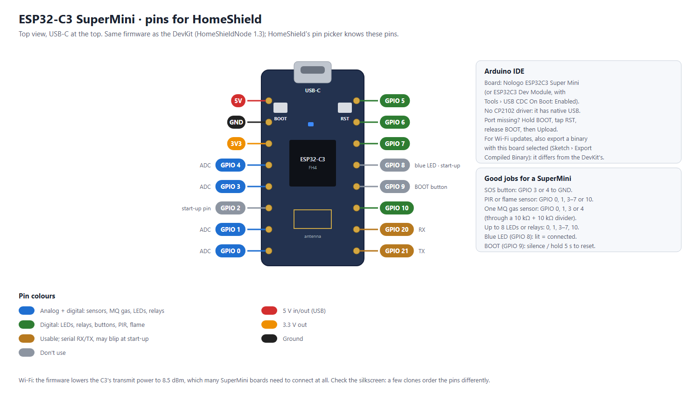

# HomeShield node (ESP32)

One sketch for every ESP32 in the house. You flash it once over USB; after that the board is set up from the dashboard: its name and room, what is wired to which pin, and firmware updates, all over Wi-Fi.

A node can switch relays (lights, sockets, a fan, a door lock, a valve), dim a lamp, sound a buzzer, and read an SOS button, a PIR motion sensor, a flame or water-leak sensor, an MQ-2 gas sensor and a DHT11/DHT22 temperature and humidity sensor. The original single-board buzzer sketch is still in [`../HomeShieldBuzzer`](../HomeShieldBuzzer) for USB-only use.

## Before you start: the HomeShield computer

ESP32 nodes talk to HomeShield through [Mosquitto](https://mosquitto.org/), an MQTT broker. HomeShield starts its own copy on **port 1884** with its own accounts, so it doesn't touch a Mosquitto service you may already run on 1883.

1. Install Mosquitto once:
   ```bash
   winget install EclipseFoundation.Mosquitto
   ```
2. Start HomeShield as usual. The console says `ESP32 nodes: MQTT broker on port 1884`, and the sidebar shows **MQTT broker: Connected**.
3. The first time a board connects, Windows Firewall asks about **mosquitto.exe**. Allow it on **Private networks**, or boards can't reach the broker.

Options: `--mqtt-port 1885` if 1884 is taken, `--no-mqtt` to run without the broker.

## Flash the sketch (once per board)

In the Arduino IDE:

1. **Boards Manager**: install **esp32 by Espressif Systems** (version 3.x).
2. **Library Manager**: install **WiFiManager** (by tzapu), **PubSubClient** (by Nick O'Leary), **ArduinoJson** (version 7, by Benoit Blanchon) and **DHT sensor library** (by Adafruit; accept its dependency Adafruit Unified Sensor).
3. Open `firmware/HomeShieldNode/HomeShieldNode.ino`, choose the board **ESP32 Dev Module** and the board's COM port, and press **Upload**.

If the board has no COM port, Windows is missing the CP2102 driver: install the Silicon Labs **CP210x VCP** driver, or look under Windows Update → Advanced options → Optional updates → Driver updates.

## ESP32-C3 SuperMini

The same sketch runs on an ESP32-C3 SuperMini: a tiny, cheap board for one or two jobs (an SOS button, a PIR, a few LEDs or relays, one MQ sensor). It tells HomeShield which board it is, so the pin picker shows the C3's own pins.



- **Arduino IDE**: Board **Nologo ESP32C3 Super Mini** (USB CDC is on already). With **ESP32C3 Dev Module** instead, set **Tools › USB CDC On Boot › Enabled**, or the Serial Monitor and the `SERVER`/`KEY` commands stay silent.
- **No driver needed**: it has native USB, not a CP2102. If no port appears, hold **BOOT**, tap **RST**, release BOOT, and upload.
- **Pins**: GPIO 0, 1, 3 and 4 also read analog (an MQ gas sensor goes on one of these, through the same 10 kΩ + 10 kΩ divider); 5, 6, 7 and 10 are digital; 20 and 21 work but are the serial RX/TX and may blip at start-up. **Avoid 2, 8 and 9**: they decide how the chip starts, 8 drives the blue LED and 9 is BOOT. HomeShield refuses them.
- **Its LED and BOOT**: the blue LED on GPIO 8 (lit when connected) and BOOT on GPIO 9 do the same jobs as on the DevKit.
- **Wi-Fi**: many SuperMini boards can't join Wi-Fi at full power because their small antenna is badly tuned, so the firmware lowers the C3's transmit power to 8.5 dBm. Keep it within a room or two of the router.
- **Updates over Wi-Fi**: a binary for the DevKit doesn't run on the C3. Export one per board: select the board, then **Sketch › Export Compiled Binary**. HomeShield sends each node the file for its own chip (`build/esp32.esp32.esp32/` for the DevKit, the folder with `c3` in its name for the SuperMini).

## Set it up on your Wi-Fi

1. Power the board. It opens a Wi-Fi hotspot called **HomeShield-Setup-XXXXXX**.
2. Join it from a phone; a setup page opens (if not, browse to `http://192.168.4.1`).
3. Choose your home Wi-Fi and enter its password. Enter the **HomeShield address**, which is the computer's IP address shown on the ESP32 nodes page (e.g. `192.168.1.227`), and the **device key**. Both are on the ESP32 nodes page under **Add an ESP32 node**, with Copy buttons; the key stays hidden until you press **Show**.
4. The board joins your Wi-Fi and appears within seconds under **ESP32 nodes → Found on your network**. Press **Adopt**, pick a room and a name.
5. Press **+ Map another pin** for each thing wired to it. The dialog offers only the pins that suit that kind of device, and the board starts using its new pin map at once.

To move a board to another network, hold the **BOOT** button for 5 seconds: it forgets the Wi-Fi and HomeShield settings and opens the setup hotspot again.

### It doesn't appear under Found on your network

Plug the board in by USB, open the Arduino IDE's **Serial Monitor** at 115200 baud and press the board's **EN** (reset) button. It prints what it uses, e.g.

```
HOMESHIELD-NODE 1.1 id=esp32-A1B2C3 server=192.168.1.227
*wm:STA IP Address: 192.168.1.191
# HomeShield broker at 192.168.1.227:1884: no answer: ...
```

- **No `STA IP Address` line**: it couldn't join your Wi-Fi (wrong password, or a 5 GHz-only network; the ESP32 needs 2.4 GHz).
- **`server=` isn't the address on the ESP32 nodes page**: fix it by typing `SERVER 192.168.1.227` (your computer's address) in the Serial Monitor and pressing Enter, or hold BOOT 5 s and redo the setup.
- **`no answer`** with the right address: HomeShield isn't running, or Windows Firewall blocks mosquitto.exe.
- **`wrong device key`**: type `KEY ` followed by the key from the ESP32 nodes page, or redo the setup.

Other Serial Monitor commands: `INFO` (what it is using now) and `SETUP` (open the setup hotspot).

### Upload fails with "Wrong boot mode detected"

Some ESP32 boards don't switch to upload mode by themselves. Press **Upload**, and when the IDE prints `Connecting....`, hold the board's **BOOT** button until the upload starts. After the first upload, updates can come over Wi-Fi instead (below).

## Which pin for what

| Wired to | Good pins | Notes |
|---|---|---|
| Relay module (light, socket, fan, lock, valve) | 4, 5, 13, 14, 16–19, 21–23, 25–27, 32, 33 | Most relay modules switch on with LOW: leave "Switches on with LOW" ticked. |
| Dimmer (PWM: LED strip driver, MOSFET) | same as relays | 0–100 %. |
| Buzzer | 25 (any output pin) | Tick "Passive" for a buzzer that needs a tone. One buzzer per node. |
| SOS button, PIR, flame, water | any of the above | The button goes between the pin and GND. |
| PIR, flame, water (input only) | 34, 35, 36, 39 also work | No internal pull-up on these. |
| MQ-2 gas sensor (analog out) | 32–36, 39 | Only ADC1 pins work while Wi-Fi is on. Power the MQ-2 from 5 V, and divide its output down to 3.3 V. |
| DHT11 / DHT22 | any output pin | Add a 10 kΩ pull-up if your sensor isn't on a module. |

On a DevKit, pins 0, 1, 2, 3, 6–11 and 12 show in the pin picker greyed out with the reason: they are used by the BOOT button, USB serial, the blue LED or the flash chip, or decide how the board starts. (GPIO 20, 24 and 28–31 don't exist on the ESP32; 37 and 38 aren't brought out on the DevKit.)

## Wiring the sensors

For the three-board test house (an SOS board, a board with five room lights and the buzzer, and a sensors board with an MQ-5, flame sensor and PIR), see **[../plans/README.md](../plans/README.md)**: house plan, one circuit per board, and what to enter for each pin.

An MQ-5 (methane / natural gas) wires exactly like the MQ-2 below; when mapping it, pick *Sensor: MQ-5* so HomeShield uses its curve.

One board can carry all of these. A plan that leaves room for relays:

| GPIO | Wired to | Map it as |
|---|---|---|
| 25 | Buzzer module (I/O pin) | Alarm buzzer (passive, switches on with LOW) |
| 33 | SOS push button, other leg to GND | SOS button |
| 34 | MQ-2 AO, through the divider below | Gas sensor (MQ-2) |
| 35 | Flame sensor DO | Flame sensor |
| 32 | HC-SR501 OUT | Motion sensor (PIR) |
| 39 (VN) | Water leak module DO | Water leak sensor |

**MQ-2 gas sensor module.** VCC to **VIN** (5 V: the heater needs it), GND to GND. Its AO pin can reach 5 V, more than the ESP32 takes, so halve it: AO → 10 kΩ → GPIO 34, and GPIO 34 → 10 kΩ → GND. Leave DO unconnected. On the Sensors page, set *MQ-2 output (AO) wiring* to **10 kΩ + 10 kΩ** (or what you used).
- A new MQ-2 needs 24–48 hours powered before its readings settle. After that, press **Calibrate** on the Sensors page with the sensor in clean air (windows open, no cooking). Until then HomeShield uses the cleanest air it has seen, which is rougher.
- After every power-up the heater needs about a minute: HomeShield ignores the gas sensor for the first 90 seconds after the board starts.
- Readings are LPG ppm (cooking gas) estimated from the datasheet curve. Treat them as a warning, not a measurement: an MQ-2 is not a certified gas alarm.

**Flame sensor module (IR, 3 or 4 pins).** VCC to **3V3**, GND to GND, DO to GPIO 35. DO goes LOW when it sees a flame, so keep *Active when the pin is LOW* ticked. Turn its little screw until the module's LED lights only for a lighter flame about 30 cm away. It also sees sunlight and halogen lamps: point it away from windows.

**Water leak module (probe + board).** VCC to **3V3**, GND to GND, DO to GPIO 39. Lay the probe flat where water would collect (under the sink or the washing machine). DO goes LOW when wet; keep *Active when the pin is LOW* ticked.

**HC-SR501 PIR motion sensor.** VCC to **VIN** (it needs 5 V), GND to GND, OUT to GPIO 32 (its output is 3.3 V, safe). Set the jumper to **H** (repeat) and the time screw fully anticlockwise (about 3 s), so HomeShield sees each movement. It can report motion for up to a minute after power-up while it settles. Motion only raises the alarm while HomeShield is set to **Away** (top bar); at Home it is only counted.

## Firmware updates over Wi-Fi

1. Change `FIRMWARE` at the top of the sketch (e.g. `"1.4"`) so HomeShield can tell old boards from new.
2. In the Arduino IDE: **Sketch → Export Compiled Binary**. This writes `firmware/HomeShieldNode/build/<board>/HomeShieldNode.ino.bin`, where HomeShield looks for it. If you have both kinds of board, do it once with **ESP32 Dev Module** selected and once with **Nologo ESP32C3 Super Mini**.
3. Boards on an older version show **UPDATE** on the ESP32 nodes page. Press **Update over Wi-Fi** on one node, or **Update N nodes** at the top. Each board downloads the file from HomeShield (with its device key), installs it and restarts.

Updates work only on your home network, never through the Cloudflare tunnel.

## What the board shows

- **Blue LED**: steady when connected to HomeShield; a short flash every 2 s when not; fast blinking while its buzzer sounds, or for 10 s after **Blink LED** on the dashboard (to find which board is which).
- **BOOT button**: a short press silences the alarm on every buzzer; hold 5 s to reset the setup.

## How it talks to HomeShield

Its `info` message also says which board it is (`"board": "esp32"` or `"esp32c3"`). Each board logs in to the broker as `node` with the device key, and may only use its own topics (`homeshield/<name>/…`) and read the alarm line. Topics:

| Topic | Direction | What |
|---|---|---|
| `homeshield/<name>/status` | board → | `online`; the broker publishes `offline` when the board disappears (last will) |
| `homeshield/<name>/info` | board → | firmware, IP, Wi-Fi signal, uptime |
| `homeshield/<name>/config` | → board | the pin map (retained, so a restarted board gets it back at once) |
| `homeshield/<name>/pin/<n>/set` | → board | switch or dim an output |
| `homeshield/<name>/pin/<n>/state` | board → | an output's state or a sensor reading: `1`/`0`, `{"mv": 812}` (gas), `{"t": 27.5, "h": 66}` (DHT) |
| `homeshield/<name>/event` | board → | `SOS` (the SOS button), `BTN` (BOOT pressed) |
| `homeshield/<name>/cmd` | → board | `blink`, `restart`, `update <url>`, `forget` |
| `homeshield/alarm` | → all boards | the alarm every buzzer plays (`ALARM FIRE 1729`, `STOP 1730`) |

## Trying it without hardware

`tools/sim_node.py` pretends to be ESP32 nodes, talking MQTT exactly like this sketch:

```bash
python tools/sim_node.py --key <device key> --boards 3
```

They show up under Found on your network, can be adopted and mapped, follow switches, and report made-up sensor readings. To try the Sensors page, write readings into `tools/sim_control.json` while it runs, per node and pin: millivolts for a gas sensor, `1`/`0` for the others.

```json
{"node-kitchen": {"34": 1500, "35": 1}}
```

That is a gas leak of about 2000 ppm and a flame in the kitchen. `{}` puts everything back to normal.
