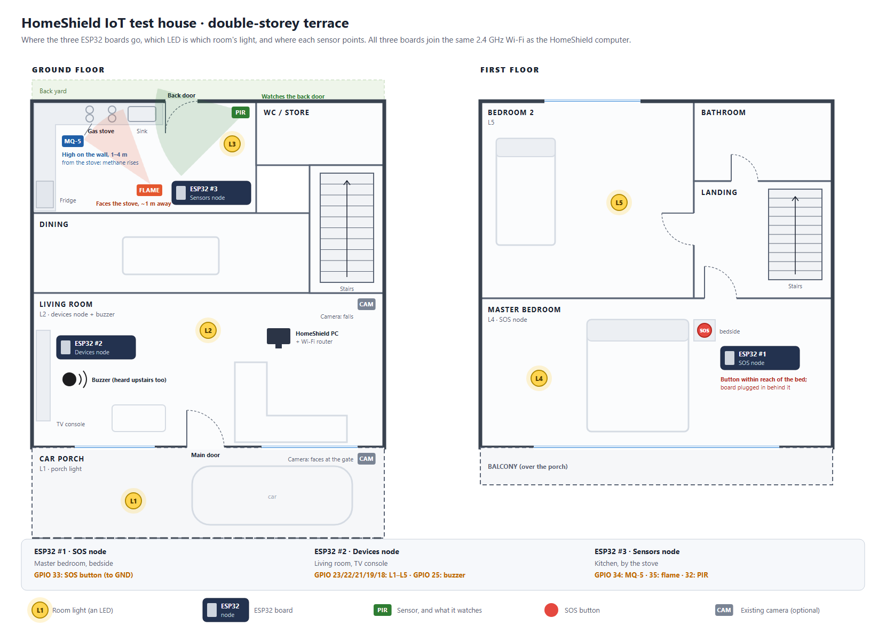
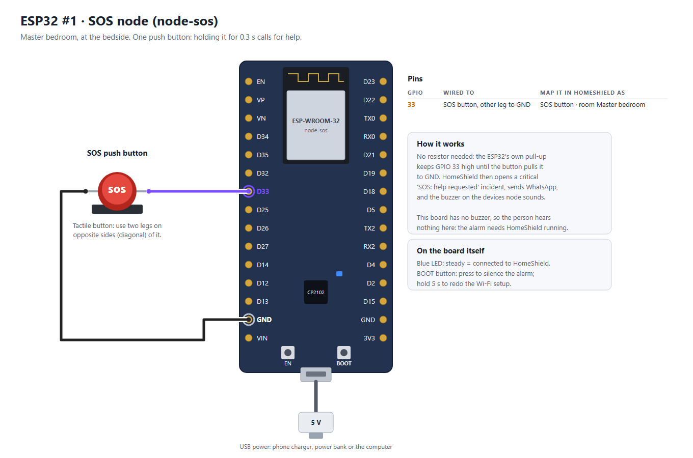
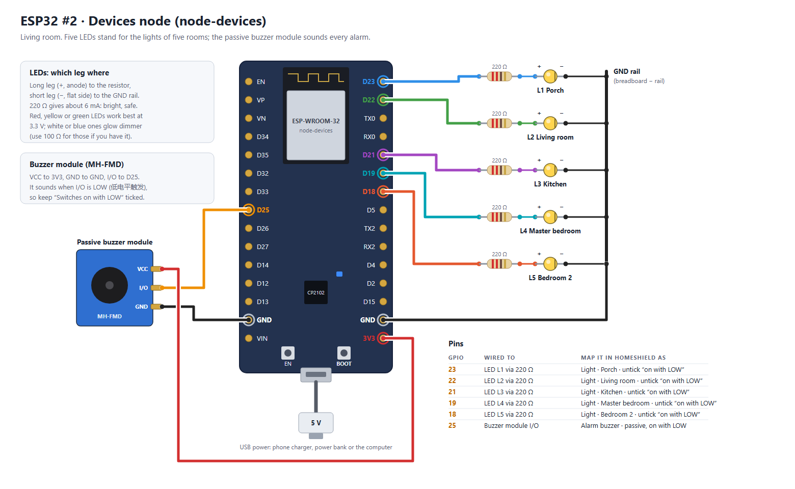
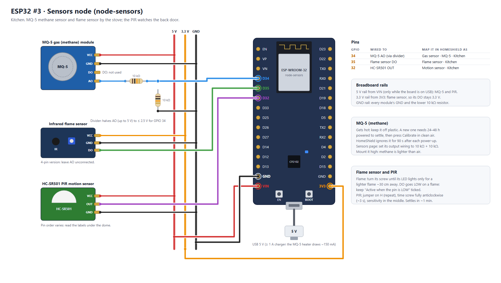

# HomeShield IoT test setup: three ESP32 boards

A double-storey terrace house, built with three ESP32 DevKits (CP2102). Each board runs the same sketch, `firmware/HomeShieldNode` (version 1.2), and does one job.

| Board | Name in HomeShield | Where | What is wired |
|---|---|---|---|
| ESP32 #1 | `node-sos` | Master bedroom, bedside | SOS push button |
| ESP32 #2 | `node-devices` | Living room, TV console | 5 LEDs (one light per room) + passive buzzer module |
| ESP32 #3 | `node-sensors` | Kitchen, by the stove | MQ-5 methane sensor, IR flame sensor, HC-SR501 PIR |

The five lights: **L1 Porch, L2 Living room, L3 Kitchen, L4 Master bedroom, L5 Bedroom 2.** The buzzer sits in the living room, the middle of the house, so it is heard upstairs too.

## Parts

| Board | Parts |
|---|---|
| SOS node | 1 push button, 2 jumper wires |
| Devices node | 5 LEDs (red, yellow or green are brightest at 3.3 V), 5 × 220 Ω resistors, MH-FMD passive buzzer module, breadboard, ~12 jumper wires |
| Sensors node | MQ-5 module, IR flame sensor module, HC-SR501, 2 × 10 kΩ resistors, breadboard, ~14 jumper wires (some male–female for the modules) |

Each board needs a USB cable and 5 V: a phone charger, a power bank or the computer. Give the sensors node a charger of at least 1 A, because the MQ-5's heater draws about 150 mA.

## 1. SOS node (ESP32 #1)

| GPIO | Wired to | In HomeShield |
|---|---|---|
| 33 | Push button; its other leg to **GND** | **SOS button**, room *Master bedroom* |

There's no resistor: the ESP32's internal pull-up holds the pin high until the button pulls it to GND. On a 4-leg tactile button, use two legs on opposite corners.

This board has no buzzer, so pressing SOS makes no sound here. HomeShield (which must be running) opens a critical **SOS: help requested** incident, sends WhatsApp, and sounds the buzzer on the devices node.

## 2. Devices node (ESP32 #2)

| GPIO | Wired to | In HomeShield |
|---|---|---|
| 23 | 220 Ω → LED L1 (+) | **Light**, name *Porch light*, room *Porch* |
| 22 | 220 Ω → LED L2 (+) | **Light**, *Living room light*, room *Living room* |
| 21 | 220 Ω → LED L3 (+) | **Light**, *Kitchen light*, room *Kitchen* |
| 19 | 220 Ω → LED L4 (+) | **Light**, *Master bedroom light*, room *Master bedroom* |
| 18 | 220 Ω → LED L5 (+) | **Light**, *Bedroom 2 light*, room *Bedroom 2* |
| 25 | Buzzer module **I/O** (VCC → 3V3, GND → GND) | **Alarm buzzer**, room *Living room* |

- **Each LED's long leg (+)** goes to its resistor. **The short leg (−, flat side of the rim)** goes to the breadboard's − rail, and that rail goes to a **GND** pin.
- When mapping each LED, **untick "Switches on with LOW"**. That box is for relay modules; an LED wired like this lights when the pin is HIGH.
- For the buzzer, keep **Passive** and **"Switches on with LOW"** ticked. The MH-FMD sounds when I/O is LOW (低电平触发). The tone is 2700 Hz.
- Optional: map one LED as a **Dimmable light** instead of a Light (any of these pins can dim). It then gets a 0–100 % slider.

## 3. Sensors node (ESP32 #3)

| GPIO | Wired to | In HomeShield |
|---|---|---|
| 34 | MQ-5 **AO** through a 10 kΩ, with 10 kΩ from GPIO 34 to GND | **Gas sensor (MQ-2 / MQ-5)**, Sensor **MQ-5 (methane, natural gas)**, room *Kitchen* |
| 35 | Flame sensor **DO** | **Flame sensor**, room *Kitchen* |
| 32 | HC-SR501 **OUT** | **Motion sensor (PIR)**, name *Back door motion*, room *Kitchen* |

Power comes from three breadboard rails:
- **5 V rail**, from **VIN**: MQ-5 VCC and PIR VCC. VIN gives 5 V only while the board is powered by USB.
- **3.3 V rail**, from **3V3**: flame sensor VCC, so its DO output never goes above 3.3 V.
- **GND rail**: every GND, plus the lower 10 kΩ resistor.

**MQ-5**
- **Why the divider:** AO can reach 5 V, but GPIO 34 must stay below 3.3 V. The two 10 kΩ resistors halve it, to at most 2.5 V.
- **After mapping:** on the Sensors page, set *MQ-5 output (AO) wiring* to **10 kΩ + 10 kΩ**.
- **Calibrating:** a new MQ-5 needs 24–48 hours powered to settle. Then press **Calibrate** with the room aired out. Until then, HomeShield uses the cleanest air it has seen.
- **Warm-up:** HomeShield ignores the gas reading for 90 s after each power-up, while the heater warms.
- **Default levels:** warning at **1,000 ppm**, danger at **5,000 ppm** (10 % of methane's explosive limit). You can change them on the Sensors page.
- **Mounting:** high on the wall near the stove, since methane rises. The heater gets hot: keep it away from plastic and fingers.

**Flame sensor**
- Turn its screw until its LED lights only for a lighter flame about 30 cm away.
- Point it at the stove, away from windows: sunlight and halogen lamps also trigger it.
- Keep **"Active when the pin is LOW"** ticked.

**HC-SR501**
- Put the jumper on **H** (repeat trigger), turn the time screw fully anticlockwise (about 3 s), and set sensitivity to the middle.
- It may report motion for up to a minute after power-up while it settles.
- It raises the alarm only while HomeShield is set to **Away**; at Home it only counts.

## Setting up, in order

1. **Flash** `firmware/HomeShieldNode` (1.2) to all three boards from the Arduino IDE. If the upload says *Wrong boot mode*, hold **BOOT** when the IDE prints `Connecting....`.
2. **Wi-Fi:** for each board, join its **HomeShield-Setup-…** hotspot from a phone. Enter your 2.4 GHz Wi-Fi, and the computer's address and device key, both on the ESP32 nodes page under **Add an ESP32 node** (Copy buttons; press Show to see the key). Do one board at a time, so you know which is which (or use **Blink LED**).
3. **Adopt** each one on **ESP32 nodes**: `node-sos` (room *Master bedroom*), `node-devices` (*Living room*), `node-sensors` (*Kitchen*).
4. **Map the pins** as in the tables above, with **+ Map another pin** on each node.

## Test plan

| Test | Do | Expect |
|---|---|---|
| Lights | Devices page: switch each light on and off | The matching LED follows within a second; the activity log names you |
| Scene | Make a scene *Night*: L4 on, others off. Run it | LEDs change together |
| Buzzer | Devices page: **Test** on the buzzer | Three beeps |
| SOS | Hold the SOS button for half a second | Critical **SOS** incident (Master bedroom), buzzer sounds, WhatsApp if set up; BOOT on any board silences it |
| Motion | Switch the top bar to **Away**, wave at the PIR | **Motion detected · Kitchen** banner, intruder incident, buzzer |
| Flame | Light a lighter ~30 cm in front of the flame sensor for 3 s, **away from the MQ-5** | **Flame detected** banner, fire incident, buzzer (fire pattern) |
| Gas | After the warm-up, hold an **unlit** lighter near the MQ-5 and press its gas button for 2–3 s | The reading climbs on the Sensors page chart; warning, then danger if it stays high |

> Never do the gas test and the flame test together, and never near a real gas leak. An MQ-5 also reacts to the butane in a lighter, so the "methane" number in this test is only a rough figure.

## Adding an ESP32-C3 SuperMini

A fourth node can be an ESP32-C3 SuperMini: same firmware, smaller board, its own pins. See [esp32c3-supermini.png](esp32c3-supermini.png) and the SuperMini section of [../HomeShieldNode/README.md](../HomeShieldNode/README.md#esp32-c3-supermini). For example, a second SOS button for Bedroom 2: button between **GPIO 4** and **GND**, mapped as **SOS button**.

## Automations to try

On the **Automations** page:
- **Arm & leave** (starter): switch it on. Switching to Away turns every light off.
- **Evening lights** (starter): switch it on, and edit it so it turns on only the **Porch light** at sunset.
- **Back door motion · active while away** (made by the Sensors page): **Edit rule →**, then add **Turn on Kitchen light** and **Turn on Porch light** before the buzzer.
- **New: SOS → lights on.** When *A camera detects something → SOS button pressed*, then turn on the **Master bedroom light** and the **Living room light**, and Notify.
